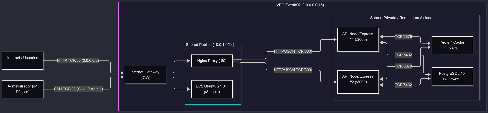

# EventoYa — Arquitectura y Despliegue

Plataforma de gestión de eventos y venta/reserva de boletas de **EventoYa**, diseñada como un monolito modular contenerizado con orquestación mediante **Docker Compose** y despliegue en **AWS** (`t3.micro` en VPC `10.0.0.0/16`).

## Arquitectura del Sistema

* **Proxy inverso y balanceo:** Nginx (`eventoya_proxy`) exponiendo el puerto `80` (`HTTP`).
* **Aplicación backend:** Dos réplicas de la API en Node.js y Express (`eventoya_api_1` y `eventoya_api_2`) en el puerto interno `3000`.
* **Caché e idempotencia:** Redis 7 (`eventoya_cache`, puerto interno `6379`) bajo patrón *Cache-Aside* (TTL de 30 s) y control de claves de idempotencia.
* **Persistencia transaccional:** PostgreSQL 15 (`eventoya_db`, puerto interno `5432`) con restricciones de integridad y volumen persistente.
* **Aislamiento de red:** Red interna aislada (`backend_net` con `internal: true`) sin exponer puertos de API, caché o base de datos al host ni a Internet.



## Documentación del Repositorio

* **Requerimientos No Funcionales:** [docs/rnf.md](docs/rnf.md) (8 RNF medibles, incluyendo latencia, concurrencia, costo `<= 25 USD/mes` y RTO/RPO).
* **Decisiones de Arquitectura (ADR):**
  * [ADR-001: Monolito modular y despliegue único](docs/adr/ADR-001-monolito-modular-despliegue-unico.md)
  * [ADR-002: Idempotencia y control de concurrencia en boletas](docs/adr/ADR-002-idempotencia-y-control-concurrencia-boletas.md)
  * [ADR-003: Caché en memoria con Redis 7 para disponibilidad de eventos](docs/adr/ADR-003-cache-redis-disponibilidad-eventos.md)
* **Arquitectura y Red:**
  * [Diagrama C4 Nivel 2](docs/arquitectura/c4-nivel-2.md)
  * [Plan de Red en AWS](docs/arquitectura/red.md)
  * [Arquitectura de Red, Puertos y Seguridad](docs/arquitectura/red-y-seguridad-aws.md)
  * [Infraestructura](docs/arquitectura/infraestructura.md)
  * [Hoja de Estimación](docs/arquitectura/hoja-de-estimacion.md)
* **Despliegue y Evidencias:** [docs/despliegue.md](docs/despliegue.md) y carpeta [evidencias/](evidencias/).

## Ejecución Local con Docker Compose

```bash
docker compose up -d --build
docker compose ps