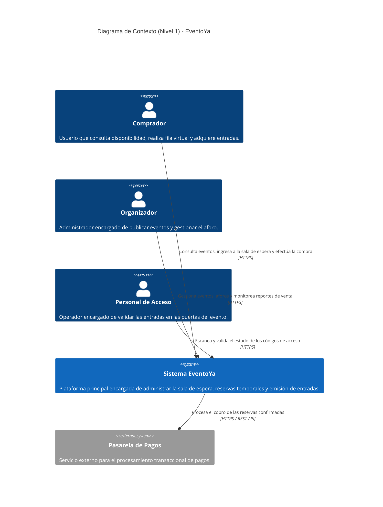

# Arquitectura del Sistema - EventoYa

## Descripción General
Plataforma web para la gestión y venta masiva de boletería en línea, diseñada para mitigar fallas por alta concurrencia, prevenir la sobreventa de entradas y garantizar la disponibilidad del servicio durante eventos de alta demanda.

---

## Diagrama C4 - Nivel 1: Contexto del Sistema


---


## Diagrama C4 - Nivel 2: Contenedores del Sistema
```mermaid
C4Container
    title Diagrama de Contenedores (Nivel 2) - EventoYa

    Person(cliente, "Comprador", "Usuario que interactúa con la plataforma para la compra de boletas.")
    
    Container_Boundary(api_boundary, "Plataforma EventoYa") {
        Container(proxy, "Servidor Proxy y Balanceador", "Nginx", "Gestiona las peticiones entrantes, distribuye la carga y administra conexiones seguras SSL/TLS.")
        Container(api, "Servicio Backend (API REST)", "Node.js / Express", "Procesa la lógica del negocio, gestiona reservas, control de aforo y comunicación con la pasarela.")
        ContainerDb(cache, "Servicio de Caching y Colas", "Redis", "Maneja la cola de espera en memoria, la expiración temporal de reservas y sesión de usuarios.")
        ContainerDb(db, "Base de Datos Relacional", "PostgreSQL", "Almacena la información de usuarios, eventos, boletas emitidas y registros transaccionales.")
    }

    System_Ext(pasarela, "Pasarela de Pagos", "Servicio Externo")

    Rel(cliente, proxy, "Peticiones web y solicitudes de compra", "HTTPS")
    Rel(proxy, api, "Redirige y balancea las solicitudes de los clientes", "HTTP")
    Rel(api, cache, "Verifica disponibilidad inmediata y administra turnos de espera", "Redis Protocol")
    Rel(api, db, "Registra compras confirmadas y mantiene la persistencia de datos", "SQL / TCP 5432")
    Rel(api, pasarela, "Solicita la autorización y cobro de transacciones", "HTTPS / REST")