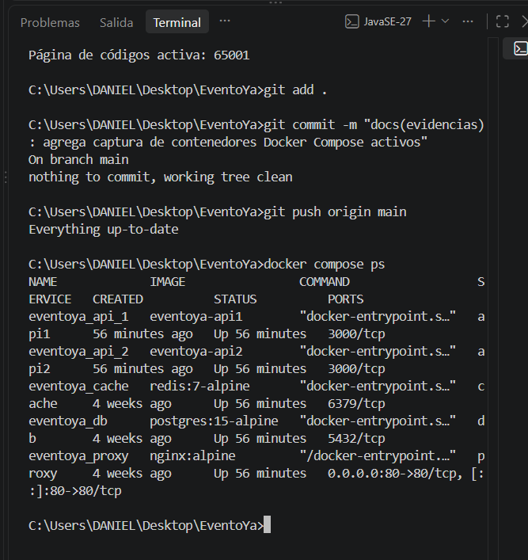

# Hoja de Estimación de Costos de Infraestructura - EventoYa

## 1. Definición de Recursos y Componentes Base
* **Backend:** Instancia EC2 `t3.small` (2 vCPU, 2 GB RAM) ejecutando los contenedores de Node.js **(D)**.
* **Base de Datos:** Instancia Amazon RDS PostgreSQL `db.t3.micro` con 20 GB de almacenamiento SSD **(D)**.
* **Servicio de Cache:** Instancia ElastiCache Redis `cache.t3.micro` **(D)**.
* **Proxy y Red:** Nginx como balanceador de carga local enrutando tráfico hacia el backend **(D)**.

## 2. Supuestos Operativos (S)
* **Tiempo de Operación:** El sistema opera de manera continua 24/7, sumando 730 horas al mes **(S)**.
* **Región de Despliegue:** US East (N. Virginia) `us-east-1` **(S)**.
* **Carga Simulada:** Infraestructura dimensionada para responder adecuadamente bajo una carga de hasta 500 usuarios concurrentes **(S)**.

## 3. Cálculos de Costos Mensuales (C)
* **Costo Instancia EC2 (Backend):** $0.0208 USD/hora × 730 horas = **$15.18 USD/mes** **(C)**.
* **Costo Base de Datos RDS (PostgreSQL):** $0.017 USD/hora × 730 horas = **$12.41 USD/mes** **(C)**.
* **Costo Cache (Redis):** $0.014 USD/hora × 730 horas = **$10.22 USD/mes** **(C)**.
* **Costo Total Estimado:** $15.18 + $12.41 + $10.22 = **~$37.81 USD/mes** **(C)**.

## 4. Evidencias de Implementación Local
La infraestructura de la arquitectura de microservicios (Backend x2, PostgreSQL, Redis y Nginx) fue desplegada y validada mediante Docker Compose:

   